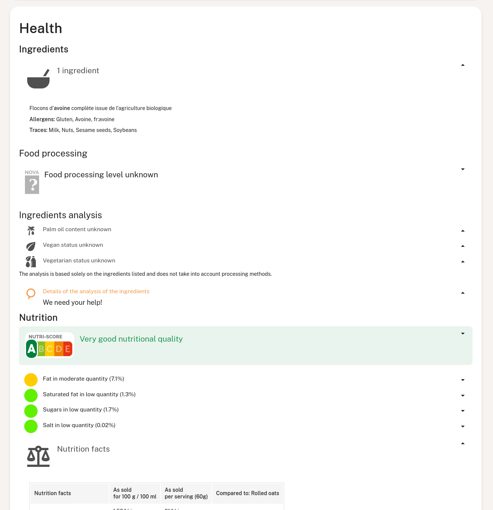

# Explanation on Knowledge panels

The Open Food Facts API allows clients (such as the Open Food Facts website and mobile app) to request ready-to-display information about an object (such as a product or a facet like a category).

Clients do not have to know in advance what kind of information is displayed (for example - the ingredients of a product, nutrition data, Nutri-Score or Eco-Score). They only have to know how to display essential data types such as texts, grades, images, and tables.

  
Knowledge panels in action on the website

Knowledge panels in action on the mobile app

## Main elements
Main elements are panels, which in turn contain elements. Elements are typically `text_element`, `image_element`, `map_element`. Some panels are grouping panels together, forming a hierarchy.
We also have a concept of action, which allows the user to take an action, currently editing.

The structure of the knowledge panels data returned by the API is described in the [knowledge panels JSON schema](https://openfoodfacts.github.io/documentation/docs/Product-Opener/schemas/schemas/product_knowledge_panels/).

> See the reference documentation for [Getting Knowledge panels for a specific product by barcode](https://openfoodfacts.github.io/documentation/docs/Product-Opener/v2/products/get-product-by-code/).

## Product panels
The `root` panel lists the cards to show on the product page, in order. Each card groups sub-panels, and most sub-panels are only sent when the product has the data. Some ids include a tag and depend on the product, for example `ingredients_analysis_en:vegan`.

| Card | Main sub-panels | Notes |
|---|---|---|
| `health_card` | `nutriscore_2023`, `nutrient_levels`, `nutrition_facts_table`, `ingredients`, `nova`, `ingredients_analysis` | Only on flavors with the health card feature |
| `environment_card` | `environmental_score`, `carbon_footprint`, `forest_footprint`, `packaging`, `origins_of_ingredients`, `threatened_species` | |
| `product_card` | `raw_brands`, `raw_countries`, `raw_stores`, `raw_labels` | |
| `report_problem_card` | `incomplete_or_incorrect_data` | Not on the producers platform |
| `contribution_card` | data quality panels, `product_history` | Data quality panels only for logged in users on the web |
| `secondhand_card` | repair, donation and used product panels | Only for the `product` product type |

## Opt-in panels
These panels are only sent when the client asks for them with a query parameter set to `1`. The parameters are described in the [API reference](https://openfoodfacts.github.io/documentation/docs/Product-Opener/v2/products/get-product-by-code/).

| Parameter | Adds |
|---|---|
| `activate_knowledge_panels_simplified` | `simplified_root` and its simplified health and environment cards |
| `activate_knowledge_panel_physical_activities` | `physical_activities` in the health card |
| `activate_knowledge_panel_product_history` | `product_history` in the contribution card, for logged in users |
| `activate_knowledge_panel_product_information` | `conservation_conditions` and `customer_service` in the product card, and a `sources_manufacturer` panel for products of a producer organization |
| `activate_knowledge_panel_related_categories` | `related_categories` on category pages |
| `activate_knowledge_panel_nova_unknown` | A panel explaining why the NOVA group is unknown, on the unknown NOVA group page |

`knowledge_panels_included` and `knowledge_panels_excluded` take a comma separated list of panel ids to keep or drop.

## How to make a knowledge panel related contribution
- You need to have a clear vision of the information you want to convey, both in synthetic and larger form
- If the information is missing to properly display the panel, you need to devise a clear way for the user to contribute it if it's available on pack, or explain that it's not available on pack

## Code-pointers
* The code contains templates and logic for creating various knowledge panels, including environmental and contribution-related panels, as seen in `templates/api/knowledge-panels/environment/label.tt.json` and `lib/ProductOpener/KnowledgePanelsContribution.pm`.
* Knowledge panels are generated based on product data and taxonomies, with support for localization and customization as per `lib/ProductOpener/KnowledgePanels.pm` (for products) and `lib/ProductOpener/KnowledgePanelsTags.pm` (for facets).

## How to test that your knowledge panel contribution does not break the app
- You can use tools such as ngrok.io to open a tunnel from your local development machine to the Internet. If you are using GitPod to run your Product Opener instance, you don't even need this step, as gitpod allows you to make your dev instance url public.
- You can then activate the DEV mode of the official Open Food Facts mobile app, switch the Server to test, and set a custom URL (yours) for the server. More details are available
