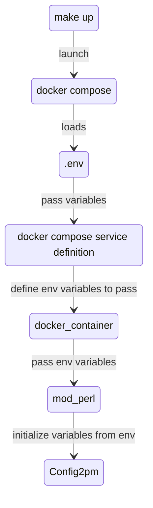

# How to use Docker to Develop - a guide

This guide is for developers and newcomers to help them debug and explore Docker.

This page describes how to test and debug your changes once you have set up the project, Product Opener with Docker using [dev environment quick start guide](how-to-quick-start-guide.md).

## Checking logs

### Tail Docker Compose logs

``` sh
make log
```

You will get logs from nginx, mongodb, postgres, etc.

### Tail other logs

Most logs from perl are not (yet ?) displayed on the docker logs,
but are instead available in specific directories.

To see them use:

``` sh
make tail
```

It will `tail -f` all the files present in the `logs/` directory:

* `apache2/error.log`
* `apache2/log4perl.log`
* `apache2/modperl_error.log`
* `apache2/other_vhosts_access.log`
* `nginx/access.log`
* `nginx/error.log`

You can also simply run:
``` sh
tail -f <FILEPATH>
```
to check a specific log.

One of the most important is `log4perl.log`.


### Increasing log verbosity

By default, the `log4perl` configuration `conf/log.conf` matches production
settings. You can tweak that file with your own dev configuration settings and
run `make restart` to reload the changes.

A setting useful for local environments is to set `TRACE` log level:
``` sh
log4perl.rootLogger=TRACE, LOGFILE
```

## Opening a shell in a Docker container

Run the following to open a bash shell within the `backend` container:

``` sh
docker compose exec backend bash
```

You should see `root@<CONTAINER_ID>:/#` (opened root shell): you are now within the Docker container and can begin typing some commands!

### Checking permissions

Navigate to the specific directory and run

``` sh
ls -lrt
```
It will list all directories and their permissions.

### Creating directory

Navigate to your specific directory using `cd` and run

``` sh
mkdir directory-name
```

### Running minion jobs

[Minion](https://docs.mojolicious.org/Minion) is a high-performance job queue for Perl, used in [openfoodfacts-server](https://github.com/openfoodfacts/openfoodfacts-server) for time-consuming import and export tasks. These tasks are processed and queued using the minion jobs queue. Therefore, they are called minion jobs.

Go to `/opt/product-opener/scripts` and run

``` sh
./minion_producers.pl minion job
```

The above command will show the status of minion jobs. Run the following command to launch the minion jobs.

``` sh
./minion_producers.pl minion worker -m production -q pro.openfoodfacts.org
```

### Restarting Apache

Sometimes restarting the whole `backend` container is overkill, and you can just
restart `Apache` from inside the container:

``` sh
apache2ctl -k restart
```

### Exiting the container

Use `exit` to exit the container.

## Making code changes

In the dev environment, any code change to the local directory will be written 
to the container. That said, some code changes require a restart of the `backend` 
container, or rebuilding the NPM assets.


## Getting away from make up

`make up` is a good command for starters,
but it's not the right one to use if you develop on a daily basis, because it may be slow,
as it does a full rebuild, which, in dev mode, should only be necessary in a few cases.

On a daily basis you could better run those:

* `docker compose up` to start and monitor the stack.
* `docker compose restart backend` to account for a code change in a `.pm` file
  (cgi `pl` files do not need a restart)
* `docker compose stop` to stop them all

If some important file changed (like Dockerfile or cpanfile, etc.), or if in doubt,
you can run `docker compose build` (or maybe it's a good time to use `make up` once)

You should explore the [docker compose commands](https://docs.docker.com/compose/reference/).
Most are useful!


### Live reload
To automate the live reload on code changes, you can install the Python package `when-changed`:
```
pip3 install when-changed
when-changed -r docker/ docker-compose.yml .env -c "make restart"                                         # restart backend container on compose changes
when-changed -r lib/ -r docker/ docker-compose.yml -c "docker compose backend restart" # restart Apache on code changes
when-changed -r html/ Dockerfile Dockerfile.frontend package.json -c "make up" # rebuild containers on asset or Dockerfile changes
```

An alternative to `when-changed` is `inotifywait`.


## Run queries on MongoDB database

``` sh
docker compose exec mongodb mongo
```

The above command will open a MongoDB shell, allowing you to use all the `mongo` 
commands to interact with the database:

``` sh
show dbs
use off
db.products.count()
db.products.find({_id: "5053990155354"})
db.products.deleteOne({_id: "5053990155354"})
```

See the [`mongo` shell docs](https://www.mongodb.com/products/shell) for more commands.

## Adding environment variables

If you need some value to be configurable, it is best to set it as an environment variable.

To add a new environment variable `TEST`:

* In a `.env` file, add `TEST=test_val` [local].
* In `.github/workflows/container-deploy.yml`, add `echo "TEST=${{ secrets.TEST }}" >> .env` to the "Set environment variables" build step [remote]. Also add the corresponding GitHub secret `TEST=test_val`.
* In `docker-compose.yml` file, add it under the `backend` > `environment` section.
* In `conf/apache-2.4/modperl.conf` file, add `PerlPassEnv TEST`.
* In `lib/Config2.pm`, add `$test = $ENV{TEST};`. Also add `$test` to the `EXPORT_OK` list at the top of the file to avoid a compilation error.

The call stack goes like this:



**Important:** Note that when you change environment variables, a restart of docker containers is not sufficient. You must destroy and re-create the container.
The best way to do it, most of the time, is `docker compose down && docker compose up -d`
(you can also destroy individual container with `docker compose rm -sf <service_name> && docker compose ud -d <service_name>`)

## Managing multiple deployments

To juggle between multiple local deployments (e.g: to run different flavors of Open Food Facts on the same host),
there are different possible strategies.

### Switching Flavors and Environments with `setenv.sh`

Docker Compose takes its settings from the environment, which overrides values in `.env`.
To juggle between flavors (`off`, `obf`, `opf`, `opff`) or the producers platform (`off-pro`), use the [`env/setenv.sh`](https://github.com/openfoodfacts/openfoodfacts-server/blob/main/env/setenv.sh) script:

```bash
# To run Open Food Facts (default)
source env/setenv.sh off
make up

# To run Open Beauty Facts
source env/setenv.sh obf
make up

# To run Open Products Facts
source env/setenv.sh opf
make up

# To run Open Pet Food Facts
source env/setenv.sh opff
make up

# To run the Producers Platform
source env/setenv.sh off-pro
make up
```

`setenv.sh` automatically unsets previous flavor-specific variables to prevent variable bleed across sessions, sources `env/env.<flavor>`, sets `EXTRA_ENV_FILE=env/env.<flavor>`, and prefixes your shell prompt with `(<flavor>)`.

### Flavor Isolation Details

Each flavor configuration in `env/env.<flavor>` provides complete isolation:

| Setting | Open Food Facts (`off`) | Open Beauty Facts (`obf`) | Open Products Facts (`opf`) | Open Pet Food Facts (`opff`) |
| :--- | :--- | :--- | :--- | :--- |
| `COMPOSE_PROJECT_NAME` | `po_off` | `po_obf` | `po_opf` | `po_opff` |
| `PRODUCT_OPENER_DOMAIN` | `openfoodfacts.localhost` | `openbeautyfacts.localhost` | `openproductsfacts.localhost` | `openpetfoodfacts.localhost` |
| `PRODUCT_OPENER_PORT` | `80` | `81` | `82` | `83` |
| `PRODUCT_OPENER_NETWORK` | `product-opener` | `po_obf_network` | `po_opf_network` | `po_opff_network` |
| `MONGODB_DATABASE` | `off` | `obf` | `opf` | `opff` |
| `POSTGRES_DB` | `minion` | `minion_obf` | `minion_opf` | `minion_opff` |
| `MINION_QUEUE` | `openfoodfacts.localhost` | `openbeautyfacts.localhost` | `openproductsfacts.localhost` | `openpetfoodfacts.localhost` |

- **Network Aliases**: Frontend network aliases are dynamically generated based on `${PRODUCT_OPENER_DOMAIN}`, preventing alias conflicts when instances run side-by-side.
- **Minion Queues**: Backend jobs are queued to the flavor's specific `${MINION_QUEUE}`, ensuring jobs are handled exclusively by the corresponding flavor worker.
- **Databases**: PostgreSQL task queue databases and MongoDB collections are completely partitioned by flavor.

### Testing Open Beauty Facts (OBF) Locally

To test OBF locally without colliding with an existing Open Food Facts deployment:

1. **Activate OBF Environment:**
   ```bash
   source env/setenv.sh obf
   ```
2. **Start Containers & Seed Sample Data:**
   ```bash
   make dev
   ```
   *(Alternatively, if running `make up`, manually seed data with `make import_sample_data_obf`)*
3. **Access the Application:**
   Open [http://openbeautyfacts.localhost:81](http://openbeautyfacts.localhost:81) or [http://world.openbeautyfacts.localhost:81](http://world.openbeautyfacts.localhost:81) in your browser.

- **Port Mapping**: OBF binds to host port `81` (`PRODUCT_OPENER_PORT=81`), allowing it to run concurrently alongside OFF on port `80`.
- **Network Aliases**: Nginx frontend containers register `${PRODUCT_OPENER_DOMAIN}` aliases (`openbeautyfacts.localhost` and `world.openbeautyfacts.localhost`) on the Docker network, ensuring internal routing is distinct from `openfoodfacts.localhost`.

### Staging Multi-Instance Deployment

On staging servers, multiple flavors run concurrently side-by-side using directory isolation:

1. **Independent Directory Checkouts**:
   - `/srv/off` checked out with `env/env.off` running on port 80.
   - `/srv/obf` checked out with `env/env.obf` running on port 81.
2. **Shared Services Network**:
   - Common infrastructure (shared MongoDB, Redis) is managed via [`openfoodfacts-shared-services`](https://github.com/openfoodfacts/openfoodfacts-shared-services) and joined over flavor-scoped shared networks (`COMMON_NET_NAME`, e.g. `off_shared_network`, `obf_shared_network`) to prevent backend/minion service alias collisions.
3. **Collision Avoidance**:
   - Unique `COMPOSE_PROJECT_NAME` prefixes (`po_off`, `po_obf`) isolate container names and default bridge networks.
   - Distinct ports (80 vs 81) and isolated Minion queues prevent task collisions, while shared volumes (`po_products`, `po_off_product_images`) ensure product history is preserved when products transition between flavors.

